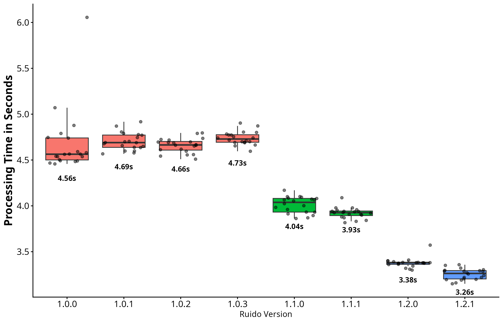

# Ruido - Development Branch


[](https://github.com/Arthurigorr/Ruido/actions/workflows/R-CMD-check.yaml)  [](https://codecov.io/gh/Arthurigorr/Ruido)

> **⚠️ Development version:** Code in this branch may be incomplete, experimental, or broken. Use the `main` branch for the stable version of Ruido!

This is the development branch of **Ruido**. Its main purpose is to test new features and changes before they are merged into the `main` branch, helping prevent untested or broken code from affecting the stable version of the package.

### Current Goals:
- [x] Create functions to calculate summarized versions of Background Noise and Soundscape Power — **100%**
  - [x] Function
  - [x] Documentation
  - [x] Examples
  - [x] Tests
  - [x] Optimize
- [ ] Create functions for the remaining spectral indices — **50%**
  - [x] Events per Second — **100%**
    - [x] Function
    - [x] Documentation
    - [x] Examples
    - [x] Tests
    - [x] Optimize
  - [ ] Spectral Peaks — **0%**
- [ ] Create a function to calculate and plot false-color spectrograms — **0%**
- [ ] Improve processing speed for `bgNoise()` — **28.5%**

### Current bottleneck and optimization targets in `bgNoise()`:
```text
BGN optimization status
│
├── FD histogram bin calculation ...... ~41%  ← main bottleneck ⚠️
│   ├── rowQuantiles / rowIQRs ........ ~39%
│   └── sorting ....................... ~12%
│
├── Spectrogram / FFT ................. ~24%
│   ├── .spect ........................ ~24%
│   └── mvfft ......................... ~11%
│
├── vapply / iteration ................ ~14%
├── Matrix subsetting ................. ~10%
├── log10() ........................... ~7%
├── abs() ............................. ~5%
├── C-level operations ................ ~3%
├── Histogram tabulation .............. ~2%
├── WAV reading ....................... ~2%
└── Other operations .................. ~5%
```

## Current Benchmark for bgNoise()

Processing time of `bgNoise()` across `Ruido` versions. Each version was evaluated over 20 repeated runs using the same three-minute-long, 48-kHz, 16-bit stereo WAV recording (GAL24576_20250401_000000.wav) from the Ruido example dataset. Benchmarks were performed on an Intel® Core™ i3-1005G1 computer with 8 GB RAM, running Arch Linux x86_64 and R 4.6.1. Individual points represent individual runs; boxes represent the interquartile range, with the horizontal line indicating the median, and whiskers extend to 1.5 × the interquartile range.
